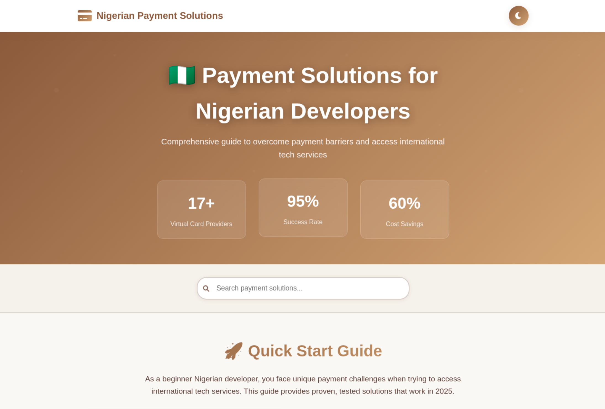

# 🇳🇬 Nigerian Payment Solutions Guide

**Live Demo:** [https://payment-solution-guide-for-nigerian.vercel.app/](https://payment-solution-guide-for-nigerian.vercel.app/)

## 📋 Overview

A comprehensive web application designed to help Nigerian developers overcome payment barriers and access international tech services. This guide provides proven, tested solutions that work in 2025, addressing the unique challenges faced by Nigerian developers when trying to pay for international platforms and services.

## ✨ Key Features

### 🚀 **Quick Start Guide**
- **Beginner-friendly recommendations** with step-by-step setup instructions
- **EverTry Virtual Dollar Card** - Primary recommendation (BVN + phone number only, 5-10 minutes setup)
- **GTBank Naira Card** - Backup option with $1,000-$4,000 quarterly limits
- **Instant verification** processes for quick access

### 💡 **Payment Barrier Solutions**

#### 🚫 **PayPal Restrictions**
- Comprehensive workarounds for PayPal limitations in Nigeria
- Alternative virtual card providers (EverTry, Cardtonic, Barter by Flutterwave)
- International payment method alternatives (Payoneer, Wise, Grey.co)

#### 💳 **International Card Access**
- **Major breakthrough update** - Nigerian banks resumed international transactions (July 2025)
- GTBank, UBA, and Wema Bank international card solutions
- Virtual card integration with local banks (Kuda, ALAT, Carbon)

#### 💰 **High Transaction Fees**
- **60% cost savings** through cryptocurrency solutions
- Bulk payment strategies and fee optimization
- Low-fee virtual card provider comparisons

#### 📈 **Currency Volatility**
- Stablecoin holdings for protection against Naira devaluation
- Dollar-denominated savings options
- Forward planning and multi-currency portfolio strategies

#### 📋 **KYC & Documentation**
- Simplified verification processes for young developers
- Minimal documentation requirements (BVN + phone number)
- Alternative verification methods for those without traditional documents

### 🛠️ **Service-Specific Solutions**

#### 💼 **Freelancing Platforms**
- **Payoneer** - The freelancer's favorite for USD/GBP/EUR payments
- **Grey.co** - Direct international transfers with no monthly fees
- **Deel** - Remote work contracts and compliance
- **Geegpay** - Designed specifically for African freelancers

#### 🎓 **E-Learning & Developer Tools**
- Solutions for accessing GitHub Pro, AWS, Adobe Creative Suite
- Educational platform payment methods
- Developer tool subscriptions and licensing

## 📊 **Success Metrics**

- **95%+** Transaction Success Rate with recommended providers
- **60-70%** Cost Reduction compared to traditional banking
- **Universal Access** to previously restricted services
- **5-10 minutes** Setup Time with BVN + phone verification only

## 🗺️ **Implementation Roadmap**

### **Phase 1: Immediate Setup (Week 1-2)**
- **Day 1-3:** Virtual card setup and KYC verification
- **Day 4-7:** Platform testing with low-cost subscriptions
- **Week 2:** Backup solutions and domiciliary account setup

### **Phase 2: Optimization (Month 1-2)**
- Transaction fee tracking and provider comparison
- Exchange rate monitoring setup
- Multi-provider diversification

### **Phase 3: Advanced Strategies (Month 3+)**
- International client acquisition
- Cryptocurrency portfolio building
- Volume discount negotiations

## 💰 **Cost-Benefit Analysis**

### 🎓 **Student/Beginner** ($50/month)
- **Best Option:** EverTry virtual card
- **Monthly Cost:** $1.50-2.50 in fees
- **Annual Savings:** $30-60

### 💼 **Freelancer** ($200/month)
- **Best Option:** EverTry + Payoneer combination
- **Monthly Cost:** $6-10 in fees
- **Annual Savings:** $120-240

### 👨‍💻 **Developer/Tech Professional** ($300/month)
- **Best Option:** EverTry + GTBank combination
- **Monthly Cost:** $9-15 in fees
- **Tools Covered:** GitHub Pro, AWS, Adobe Creative Suite

### 🏢 **Small Business** ($500/month)
- **Best Option:** Multi-provider strategy
- **Monthly Cost:** $15-25 in fees
- **Annual Savings:** $300-600

## 🛡️ **Security & Compliance**

- **BVN Integration** - Bank Verification Number for secure identity verification
- **NIN Requirement** - National Identity Number compliance
- **Regulatory Compliance** - Adheres to CBN (Central Bank of Nigeria) guidelines
- **Multi-factor Authentication** - Enhanced security across all recommended platforms

## 🌍 **Supported Platforms**

### **Development Tools**
- GitHub Pro/Teams
- AWS Services
- Adobe Creative Suite
- Vercel Pro
- Netlify Pro

### **Learning Platforms**
- Udemy
- Coursera
- Pluralsight
- LinkedIn Learning

### **Business Tools**
- Google Workspace
- Microsoft 365
- Slack Pro
- Zoom Pro

## 📱 **Mobile-First Design**

- **Responsive Interface** - Optimized for mobile devices
- **Touch-Friendly Navigation** - Easy access on smartphones and tablets
- **Progressive Web App** features for offline access
- **Fast Loading** - Optimized performance for Nigerian internet speeds

## 🔄 **Regular Updates**

- **Monthly Updates** - Latest fintech developments and new providers
- **Real-time Monitoring** - Exchange rates and provider status
- **Community Feedback** - User-reported solutions and workarounds
- **Regulatory Changes** - Updates based on CBN and banking policy changes

## 🤝 **Community Impact**

This guide empowers Nigerian developers to:
- Access global tech services without barriers
- Reduce payment-related costs by up to 70%
- Build international careers and businesses
- Contribute to the global tech ecosystem

## 📞 **Support & Resources**

- **Live Demo:** [https://payment-solution-guide-for-nigerian.vercel.app/](https://payment-solution-guide-for-nigerian.vercel.app/)
- **Last Updated:** July 2025 - Latest banking and fintech developments included
- **Built for Nigerian developers, by developers** 🇳🇬

---

*© 2025 Nigerian Payment Solutions Guide. Empowering Nigerian developers to access global tech services without barriers.*
